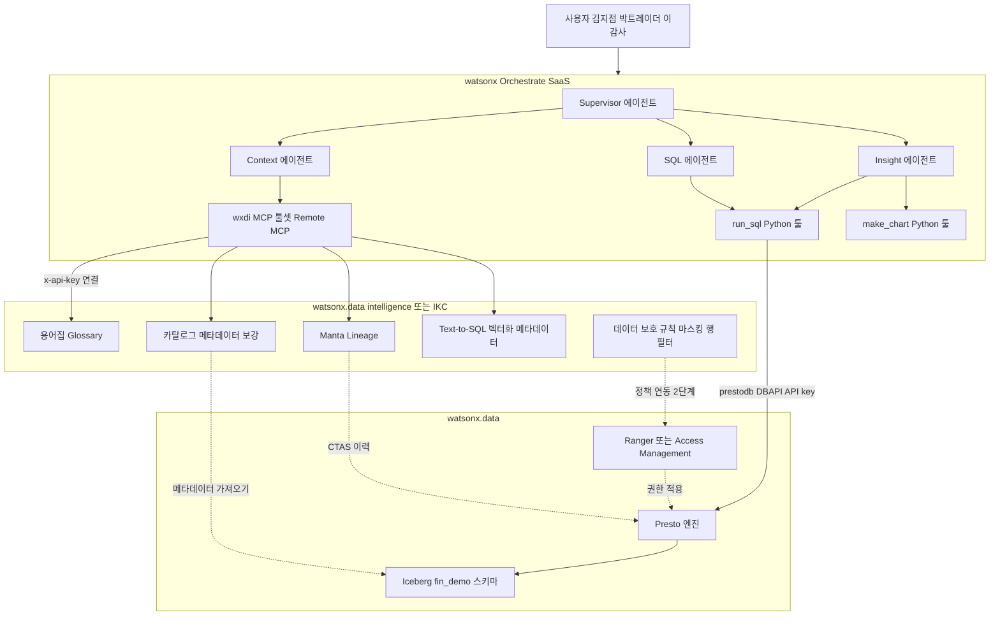
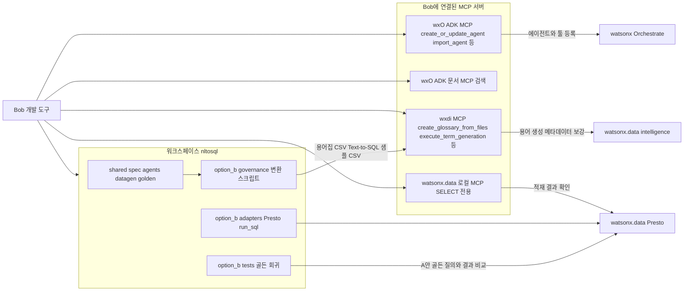

# B안: watsonx.data 인스턴스 연동형 구현 계획

마스터 플랜: [`text2sql-demo-plan.md`](text2sql-demo-plan.md) (시나리오, 에이전트 구조, 데이터 설계, 툴 인터페이스 계약은 마스터를 따른다.)
A안 플랜: [`option-a-python-plan.md`](option-a-python-plan.md)

## 개요

- **목표**: A안에서 만든 에이전트와 골든 질의를 그대로 재사용하되, 데이터와 메타데이터, 거버넌스를 watsonx.data와 watsonx.data intelligence(wxdi) 제품 기능으로 교체한다.
- **시작 조건**: TechZone watsonx.data 인스턴스 확인(B-0)이 끝나야 한다. 현재는 인스턴스를 확인할 수 없어 시작하지 않는다.
- **교체 대상**

| 영역 | A안 | B안 |
|---|---|---|
| 데이터 | Db2 SaaS | watsonx.data Presto + Iceberg (`fin_demo`) |
| `run_sql` | Db2 실행 | Presto 실행 (`prestodb` DBAPI) |
| 용어집, 카탈로그 | YAML | IKC 용어집, 메타데이터 가져오기와 보강, wxdi MCP |
| lineage | YAML 정의 | Manta Data Lineage (CTAS, INSERT INTO SELECT) |
| 마스킹, 행 필터 | 마스킹 뷰, Python 필터 | Ranger 또는 IKC 데이터 보호 규칙 |
| SQL 방언 | Db2 | Presto |

- **변하지 않는 것**: 에이전트 4종의 구조와 지침(방언 부분 제외), 툴 이름과 입출력 형식, 시나리오, 골든 질의
- **폴더**: `shared/`(재사용)와 `option_b_watsonxdata/`(`adapters/`, `load/`, `governance/`, `tests/`)

## B안 데모 스토리

"같은 에이전트가 제품 거버넌스 위에서 동작한다."
- A안과 같은 질문을 던지되 데이터는 Presto에서, 용어와 근거는 IKC와 wxdi MCP에서 가져온다.
- 추가 시연: IKC 용어집과 자동 용어 할당, 제품 Text-to-SQL과 직접 작성 SQL 비교, 페르소나별 마스킹과 행 필터, Manta lineage 그래프
- A안 골든 질의를 그대로 돌려 두 안의 결과가 같음을 보여주는 회귀 장면

## 구조 (wxdi, wxO, Bob)

### 1. 데모 실행 중 구조 (런타임)

| 구성요소 | B안에서 하는 일 | A안에서 대체되는 것 |
|---|---|---|
| wxO | 에이전트 4종 실행, 대화와 재질문, 툴 호출 | A안과 동일 |
| wxdi MCP | Context 에이전트가 용어, 카탈로그, lineage를 조회 | YAML을 읽는 `map_terms`, `get_catalog`, `get_lineage` |
| wxdi | 용어집, 메타데이터 보강, Text-to-SQL, lineage, 데이터 보호 규칙 | 직접 만든 YAML과 Python |
| watsonx.data | Presto와 Iceberg 데이터, Ranger 권한 | Db2 SaaS |
| `run_sql` | 이름과 입출력은 그대로, 내부만 Presto 실행으로 교체 | Db2 실행 |

### 2. 구축 중 구조 (Bob의 역할)

Bob은 데모 화면에 나오지 않고 만드는 단계에서 쓰인다. 이 워크스페이스에는 wxO ADK MCP 서버와 wxO ADK 문서 MCP 서버가 연결되어 있다. wxdi MCP와 watsonx.data 로컬 MCP는 이 워크스페이스에 등록되어 있는지 아직 확인하지 않았다. 아래 그림은 두 서버를 Bob에 등록한다는 가정이다.

| Bob이 하는 일 | 쓰는 것 | 대응 서브태스크 |
|---|---|---|
| 에이전트 지침과 툴 코드 작성 후 wxO에 등록 | wxO ADK MCP | B-2, B-4 |
| wxO 문서 검색으로 툴 패키징과 차트 표시 방식 확인 | wxO ADK 문서 MCP | A-2에서 먼저 사용 |
| YAML을 IKC 용어집 CSV와 Text-to-SQL 샘플 CSV로 변환 | 워크스페이스 파일 | B-3 |
| 용어집 업로드, 용어 자동 생성, 메타데이터 보강 | wxdi MCP | B-3 |
| Iceberg 적재 결과와 건수 확인 | watsonx.data 로컬 MCP | B-1 |
| A안 골든 질의를 Presto에서 돌려 결과 비교 | 어댑터와 테스트 코드 | B-2 |

구조상 미확인 가정
- wxO SaaS의 Python 툴이 TechZone Presto에 인터넷으로 도달하는지 (그림 1의 `run_sql` → Presto 화살표). 도달하지 못하면 `run_sql`을 wxdi MCP의 질의 도구로 바꿔야 할 수 있다.
- wxdi MCP의 Text-to-SQL 도구가 SQL 생성만 하는지 실행까지 하는지

## 확인된 사항 (IBM 문서 기준)

- Presto 접속: `prestodb` DBAPI 또는 JDBC. 사용자명 `ibmlhapikey_<user>`, 비밀번호 API key. 스키마 생성 시 위치를 `location = s3a://<storage-name>/` 형식으로 지정한다.
- wxdi managed 원격 MCP 서버: 엔드포인트 경로 `/semantic_agents/public/v1/mcp_server/mcp/`, API key 인증, wxO 전송 방식 `http`. 사용자가 공유한 URL은 `api.ca-tor.dai.cloud.ibm.com` 호스트이며 API key는 이 계획에 적지 않는다. (JSON 설정은 곡선 따옴표가 아니라 직선 따옴표를 써야 한다.)
- wxO 연동 절차: Manage > Connections에서 API key 연결 생성 → Agent Builder에서 에이전트 생성 → Toolset > Add tool > Agentic workflow > MCP server > Remote MCP server에서 이름, URL, 연결 지정 → 필요한 도구만 선택
- wxdi MCP 도구 영역: Lineage, 시맨틱 검색 및 질의, Text-to-SQL, 데이터 보호 및 거버넌스, 메타데이터 보강, 메타데이터 가져오기, 데이터 품질 등. 문서에 이름이 나온 도구는 `create_glossary_from_files`, `execute_term_generation`
- 제품 Text-to-SQL: 메타데이터 기반으로 SQL을 생성하며 데이터 소스 접근이 필요 없다. 프로젝트에서 자연어 질의를 켜야 하고(벡터화 작업 실행), 메타데이터 보강과 SQL 샘플 CSV로 정확도를 높인다. 한국어를 지원하며 메타데이터가 같은 언어일 때 더 정확하다.
- IKC의 watsonx.data Presto connection이 문서에서 권장되며, wxdi와의 데이터 마스킹과 규칙 보호 연동에 필요하다.
- Manta lineage는 CTAS와 INSERT INTO SELECT만 지원하고 연동을 켠 이후 시작한 작업부터 적용된다.
- Ranger는 행 필터와 컬럼 마스킹을 지원한다. IKC 연동은 행 필터용 데이터 보호 규칙을 지원한다.

## 미확인 사항 (B-0에서 검증)

- TechZone 인스턴스에 Presto, IKC 또는 wxdi, Ranger, Manta, Text-to-SQL(생성형 AI)이 포함되어 있는지
- wxO SaaS의 Python 툴이 TechZone Presto에 인터넷으로 도달 가능한지
- wxdi MCP 도구의 정확한 이름과 파라미터, Text-to-SQL 도구가 SQL 생성만 하는지 실행까지 하는지 (상세 목록은 GitHub `TOOLS_PROMPTS.md`)
- 제품 Text-to-SQL 관련 기능의 지원 상태(문서에서 동적 뷰의 자연어 질의 옵션은 기술 프리뷰로 표시되어 있다.)
- 한국어 용어와 질의에 대한 실제 정확도

---

## 1단계: 기능 구현 — B-0 ~ B-6

### B-0. 인스턴스 확인 (시작 게이트)
- **Intent**: B안이 의존하는 환경과 도구를 확인해 어디까지 제품 기능으로 갈 수 있는지 확정한다.
- **Expected Outcomes**: 환경 가능 여부 표와 폴백 결정이 기록되어 있다. 이 결과에 따라 B-1 이후 범위가 정해진다.
- **Todo List**
  1. TechZone 예약 정보에서 watsonx.data와 wxdi 접속 URL, 계정, API key 발급 경로를 확인한다.
  2. watsonx.data 콘솔에서 Presto 엔진 상태, catalog, storage를 확인한다.
  3. wxdi 쪽 IKC 사용 가능 여부, 프로젝트에서 자연어 질의(Text-to-SQL) 활성화 가능 여부, Manta 포함 여부를 확인한다.
  4. 사용 가능한 접근 정책 방식(Access Management, IKC, Ranger)을 확인한다.
  5. wxdi MCP 서버에 API key로 접속해 도구 목록을 조회하고, 사용할 도구 후보를 정리한다. (Text-to-SQL, 시맨틱 검색, lineage, 용어집)
  6. Presto 외부 접근 가능 여부를 wxO SaaS Python 툴에서 확인한다. 불가하면 중계 방식을 정한다.
  7. 결과에 따라 각 영역을 제품 기능으로 할지 A안 구현을 유지할지 정한다.
- **Relevant Context**: 위 "미확인 사항"
- **Status**: `[ ] pending (인스턴스 확인 후 시작)`

### B-1. Presto 연결과 데이터 적재
- **Intent**: A안과 같은 합성 데이터를 watsonx.data에 올린다.
- **Expected Outcomes**: `fin_demo`가 Iceberg에 적재되어 있고 건수와 FK 정합성이 A안과 같다.
- **Todo List**
  1. Presto 접속 정보를 환경 변수 또는 비밀 설정으로 분리한다. (코드에 하드코딩하지 않는다.)
  2. `fin_demo` 스키마 위치(storage)를 정하고 DDL을 작성한다.
  3. `shared/datagen/` 생성기의 출력을 INSERT 또는 CTAS로 적재한다. (`option_b_watsonxdata/load/`) 건수가 많아 느리면 다른 적재 방식을 검토한다.
  4. 건수, FK 정합성, NULL, 날짜 범위를 검증한다.
- **Relevant Context**: 마스터 플랜의 "데이터 설계", "확인된 사항"의 Presto 접속
- **Status**: `[ ] pending`

### B-2. run_sql Presto 어댑터와 골든 회귀
- **Intent**: 에이전트를 바꾸지 않고 실행 엔진만 교체한다.
- **Expected Outcomes**: `run_sql`이 Presto에서 동작하고, A안 골든 질의(Presto 버전)가 A안과 같은 결과를 낸다.
- **Todo List**
  1. `option_b_watsonxdata/adapters/`에 Presto 어댑터를 만든다. 툴 이름과 입출력 형식은 A안과 같게 한다.
  2. SQL 에이전트 지침의 방언 부분을 Presto로 교체한다.
  3. A안 골든 질의(Presto 버전)를 실행해 결과를 A안과 비교한다.
  4. 방언 차이로 틀리는 질의를 정리해 지침과 용어집 방언 메모에 반영한다.
- **Relevant Context**: A안 A-7 산출물, 마스터 플랜의 "툴 인터페이스 계약"
- **Status**: `[ ] pending`

### B-3. IKC 메타데이터 구성 (Glossary, Catalog, Text-to-SQL 준비)
- **Intent**: IKC에서 용어집과 보강, Text-to-SQL 준비를 마친다.
- **Expected Outcomes**: Presto connection으로 `fin_demo` 자산이 가져와지고 보강되어 있으며, 용어집과 SQL 샘플이 업로드되어 있다.
- **Todo List**
  1. IKC에 watsonx.data Presto connection을 만든다.
  2. 메타데이터 가져오기로 `fin_demo` 자산을 프로젝트에 가져온다.
  3. 프로젝트에서 자연어 질의를 활성화하고 벡터화 작업(`Onboard for generative AI`)이 완료되는지 확인한다.
  4. A안 YAML 용어집을 IKC 용어집 CSV(Name, Artifact Type, Description)로 변환해 업로드한다. (`option_b_watsonxdata/governance/`)
  5. 메타데이터 보강(이름과 설명 생성, 용어 할당, 프로파일링, 키와 관계 분석)을 실행한다.
  6. A안 골든 질의를 `text_to_sql_fewshots_<n>.csv`(natural_language_query,evidence,sql)로 변환해 프로젝트에 올린다. evidence에 동의어와 계산식을 넣는다.
  7. 용어, 설명을 한국어로 유지했는지 확인한다.
- **Relevant Context**: "확인된 사항"의 Text-to-SQL과 IKC 항목
- **Status**: `[ ] pending`

### B-4. wxdi MCP 연결과 Context 에이전트 교체
- **Intent**: Context 에이전트가 제품 메타데이터를 쓰도록 연결하고, 제품 Text-to-SQL을 직접 작성 SQL과 비교한다.
- **Expected Outcomes**: wxO에서 wxdi MCP 서버 도구가 호출되고, Context 에이전트의 `map_terms`, `get_catalog`, `get_lineage`가 제품 기능으로 동작한다. Text-to-SQL 비교 결과가 기록되어 있다.
- **Todo List**
  1. wxO Manage > Connections에서 API key 연결을 만든다. (API key는 저장소에 넣지 않는다.)
  2. Agent Builder에서 Remote MCP server를 추가한다. (서버 URL, 연결 지정, 전송 방식 `http`) 필요한 도구만 선택한다.
  3. 도구 목록과 입출력을 확인해 `map_terms`, `get_catalog`, `get_lineage` 계약에 매핑한다. 어댑터가 필요하면 `adapters/`에 만든다.
  4. Context 에이전트를 교체하고 2막 질문으로 검증한다.
  5. 제품 Text-to-SQL이 SQL 생성만 하는지 확인하고, 생성된 SQL을 `run_sql`로 실행하는 경로를 시험한다.
  6. 같은 질문 세트로 제품 Text-to-SQL과 직접 작성 SQL의 정확도를 비교한다. 결과에 따라 SQL 에이전트가 어느 쪽을 쓸지 정한다.
- **Relevant Context**: "확인된 사항"의 wxO 연동 절차와 wxdi MCP 항목
- **Status**: `[ ] pending`

### B-5. Lineage (Manta)
- **Intent**: 근거 보기에서 제품 lineage를 보여준다.
- **Expected Outcomes**: 파생 테이블과 지표의 lineage가 Manta에서 조회된다.
- **Todo List**
  1. Manta 연동을 켠다. 연동 이후 시작한 작업부터 lineage가 기록되므로 파생 테이블 생성 전에 켠다.
  2. CTAS로 파생 테이블(월별 거래대금 집계 등)을 만든다.
  3. wxdi MCP의 Lineage 도구로 조회해 `get_lineage`에 연결한다.
- **Relevant Context**: "확인된 사항"의 Manta 항목 (CTAS, INSERT INTO SELECT만 지원)
- **Status**: `[ ] pending`

### B-6. B안 데모 스크립트와 리허설 (1단계 범위)
- **Intent**: 제품 기능을 강조한 B안 1단계 데모를 만든다.
- **Expected Outcomes**: A안과 같은 질문 + 제품 기능 장면(용어 할당, Text-to-SQL 비교, lineage)이 포함된 스크립트와 리허설 통과
- **Todo List**
  1. A안 데모 스크립트를 기준으로 B안 추가 장면을 정한다.
  2. 회귀 장면(A안 골든 질의 결과 일치)을 준비한다.
  3. 전체 리허설을 수행하고 실패 지점을 수정한다.
- **Relevant Context**: 마스터 플랜의 "B안 데모 스토리"
- **Status**: `[ ] pending`

---

## 2단계: 이연 항목 (1단계 완료 후 논의) — B-7 ~ B-10

### B-7. 접근 제어 (제품 기능)
- **Intent**: Ranger 또는 IKC 데이터 보호 규칙으로 PII 마스킹과 행 필터를 적용한다.
- **Expected Outcomes**: 페르소나별로 마스킹과 지점 행 필터가 다르게 적용된다.
- **Todo List**
  1. B-0에서 확인한 방식(Access Management, IKC, Ranger)을 선택한다.
  2. 읽기 전용 서비스 계정을 만든다.
  3. 컬럼 마스킹 정책과 지점별 행 필터를 적용한다.
  4. 페르소나별 조회 결과가 다른지 검증한다.
- **Relevant Context**: "확인된 사항"의 Ranger, IKC 항목
- **Status**: `[ ] pending (2단계로 이연)`

### B-8. 가드레일 어댑터
- **Intent**: A안에서 만든 `check_input`과 게이트웨이를 B안에서도 쓰고 제품 정책과 겹쳐 쓴다.
- **Expected Outcomes**: 7막 레드팀 입력이 입력 검사, 게이트웨이, DB 정책 세 층에서 차단되고 차단 계층이 기록된다.
- **Todo List**
  1. A-12 가드레일을 Presto 어댑터에 적용한다.
  2. wxdi MCP의 데이터 보호 및 거버넌스 도구 활용 여부를 정한다.
  3. 7막 입력으로 검증한다.
- **Relevant Context**: 마스터 플랜의 "가드레일: 툴 중심 3겹 방어"
- **Status**: `[ ] pending (2단계로 이연)`

### B-9. 성능과 동시 사용
- **Intent**: Presto와 제품 기능을 쓴 경우의 응답 시간을 측정한다.
- **Expected Outcomes**: 단계별 응답 시간과 동시 질의 결과, A안과의 비교가 있다.
- **Todo List**
  1. 단계별 응답 시간을 측정한다.
  2. 3~5명 동시 질의를 시험한다.
  3. A안 결과와 비교한다.
- **Relevant Context**: A안 A-13
- **Status**: `[ ] pending (2단계로 이연)`

### B-10. 운영성과 7막, 8막 리허설
- **Intent**: 감사 로그와 쿼리 이력을 완성한다.
- **Expected Outcomes**: 감사 로그 조회와 7막, 8막 리허설이 통과한다.
- **Todo List**
  1. 감사 로그를 기록하고 조회 방법을 준비한다.
  2. Presto 쿼리 이력(`system.runtime.queries`)은 엔진 재시작 시 사라지므로 주기적으로 export하는 절차를 정한다.
  3. 7막과 8막을 포함한 전체 리허설을 수행한다.
- **Relevant Context**: 마스터 플랜의 "8막. 운영성"
- **Status**: `[ ] pending (2단계로 이연)`

---

## 의존 관계
- B-0이 모든 B안 서브태스크의 전제다.
- 1단계 흐름: B-0 → B-1 → B-2 → B-3 → B-4 → B-5 → B-6
- B-5는 B-1(파생 테이블 생성)과 B-3(프로젝트 구성)에 의존한다.
- B안은 A안 1단계(특히 A-3~A-7의 에이전트 지침과 골든 질의)가 끝난 뒤 시작하는 것을 권장한다.
- 2단계: B-7 → B-8 → B-9, B-10
